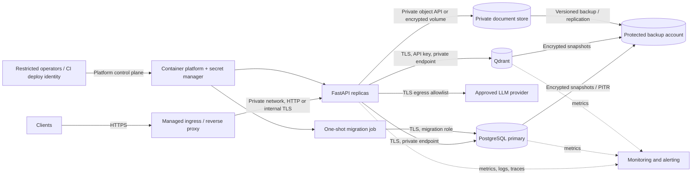

# Phase 11: Production Deployment Architecture

**Status:** Architecture and implementation plan only. No production deployment changes are implemented by this document.

## 1. Executive summary

SecureRAG has a FastAPI backend, PostgreSQL metadata and authorization state, Qdrant vector search, and a local Docker Compose development topology. The checked-in code includes meaningful security controls, including tenant context from authenticated memberships, PostgreSQL authorization checks after vector candidate retrieval, shared PostgreSQL-backed login and registration limits, upload byte limits, trusted-host support, and retryable document-permission synchronization.

At the Phase 11.2 starting revision, the repository did not define or verify a production deployment. The backend image ran as root, Compose was a local development stack, runtime and Alembic used the same configured database URL, document bytes used a filesystem path, and there was no production ingress, deployment health policy, capacity policy, backup automation, or live-service integration workflow. The existing assessment explicitly leaves live PostgreSQL/Qdrant behavior and deployment controls unverified. Phase 11.2 implementation status and evidence are recorded under the roadmap below; this document still does not claim production readiness.

The proposed target is a private, containerized API behind a managed TLS ingress; managed or equivalently operated PostgreSQL and Qdrant on private networks; encrypted persistent document storage; a one-shot migration job with a separate migration role; an application role restricted to runtime needs; centrally managed secrets; and tested backup and restore procedures. PostgreSQL remains the authority for tenant membership, document status, and document ACL decisions. Qdrant filters reduce candidate exposure and load but never grant access. Permission synchronization failures must be visible and retried; stale vector payloads cannot override a PostgreSQL denial.

This is a design, not a production-readiness claim. Infrastructure choices, recovery objectives, traffic targets, and provider-specific controls remain open until owners select them.

## 2. Current architecture and verified implementation

This table records the verified Phase 11.1 baseline at commit `b803797c1da32906d755a84b7de11ef213f687e7`, before Phase 11.2 runtime hardening. It is not a claim that the deployment is production-ready.

| Area | Verified current behavior | Boundary or gap |
| --- | --- | --- |
| API process | `backend/Dockerfile` uses `python:3.12-slim` and starts Uvicorn on port 8000. | No `USER`, container health check, worker count, CPU/memory limit, or read-only filesystem policy is declared. |
| Local topology | `docker-compose.yml` defines PostgreSQL 16, Qdrant 1.13.2, and backend services with named data volumes and health checks for the databases. Published ports bind to loopback. | This is a development Compose file, not a production ingress, orchestration, network policy, TLS, backup, or resource-limit definition. The backend service has no health check. |
| Configuration | `backend/app/config.py` validates production mode, non-placeholder signing secret, explicit trusted hosts, PostgreSQL URL, Qdrant API key, and HTTPS for remote Qdrant and LLM URLs. Secret values use Pydantic `SecretStr`. `.env.example` contains development examples. | Validation does not provision or rotate secrets, encrypt connections to PostgreSQL, or establish private network boundaries. Never promote the example `.env` values to production. |
| PostgreSQL | `backend/app/database/postgres.py` creates a process-local SQLAlchemy engine with `pool_pre_ping`, configurable pool size/overflow/timeouts/recycle, and disposes it on application lifespan shutdown. Health checks execute `SELECT 1`. | No role separation is configured by application code. Pool settings apply per process and must be budgeted against the server connection limit. |
| Migrations | `alembic.ini` points to `backend/alembic`; `backend/alembic/env.py` reads `DATABASE_URL`, uses `NullPool`, and runs versioned migrations. Six committed migration files cover users, tenants/memberships, documents, audit logs, document permissions, and auth rate limits. | The same `DATABASE_URL` setting is used by runtime and migration code; no migration job or separate credential is defined. Database rollback must not be treated as a routine automatic downgrade. |
| Qdrant | `backend/app/database/qdrant.py` creates a cached client with configured URL, optional API key, and a five-second timeout. Production config requires a Qdrant key and HTTPS URL. Compose persists Qdrant data in a named volume. | Production TLS trust, network isolation, managed persistence, backup, and restore are external responsibilities and unverified. |
| Health and shutdown | `/api/v1/health` is process liveness. `/api/v1/health/database` and `/api/v1/health/vector-db` return 503 if their dependency probes fail (the configured API prefix can change these paths). FastAPI lifespan closes the Qdrant client and disposes the SQLAlchemy engine on shutdown. | These endpoints are currently unconditional application routes, not a complete orchestrator readiness policy. Probes have not been validated against production ingress or deployment infrastructure. |
| Authentication and ingress trust | JWT auth uses configured issuer/audience and expiry. Trusted Host middleware is installed when hosts are configured. Client IP is considered behind a proxy only when the direct peer is within configured proxy CIDRs; the code uses the last `X-Forwarded-For` value. | The edge must strip and rebuild forwarding headers, restrict backend reachability, and set exact proxy CIDRs. Only login (10 requests/client/60 seconds) and registration (5/client/hour) have shared database-backed limits. Expensive routes need edge limits and concurrency controls. |
| Request controls | ASGI middleware counts streamed request bytes and enforces the configured upload limit plus overhead; validation and security tests cover body limits. | The proxy and ASGI server still need header limits, body-read timeouts, connection limits, and total concurrency limits. Per-request size limits do not bound concurrent PDF parsing or embedding work. |
| Document bytes | `backend/app/documents/storage.py` writes files below `DOCUMENT_STORAGE_PATH` and uses temporary-file/atomic replacement behavior. Compose mounts a named documents volume. | This is local filesystem storage. Multi-replica shared semantics, encryption, retention, malware scanning, and restore coordination are not supplied by the app. |
| Authorization and retrieval | Authenticated tenant context is derived from active PostgreSQL membership. Qdrant query filters use verified tenant and ACL fields. `backend/app/retrieval/service.py` loads candidate documents from PostgreSQL and `can_access_document` checks tenant, completed status, public flag, role, and user ACL before returning chunk text. | Qdrant is an optimization and candidate source, never the authority. Maintain this post-filter on every retrieval path. Administrators, operators, and uploaders gain no implicit content access from their title or upload action. |
| Permission synchronization | Permission changes are recorded in PostgreSQL with a revisioned `DocumentPermissionSync` task. The synchronization code applies the current PostgreSQL ACL to Qdrant, checks chunk count and update completion, uses a processing lease, and leaves failures/superseded revisions retryable. The pending-task processor is an internal maintenance entry point; no public worker/maintenance route is registered. | The database and vector update are not one atomic transaction. A crash or unavailable Qdrant can leave stale payloads. Production needs an explicitly operated retry/reconciliation mechanism and alerting. Authorization must fail closed through PostgreSQL checks during drift. |
| Audit | The audit helper stages events on a caller's SQLAlchemy session and metadata is allowlisted; migration triggers and ORM guards enforce append-only behavior for normal application paths. Some success events are written after the business operation commits, so those operations and their audit event are not atomic (see `README.md`, `backend/app/audit/service.py`, and migration). | PostgreSQL owners/superusers and privileged infrastructure operators can alter data or bypass application-level protections. Audit retention, export, access review, and independent tamper-evident retention need operational policy. |
| CI | `.github/workflows/tests.yml` installs declared backend dependencies, runs the backend pytest suite on Python 3.12, and validates a source archive. | It does not provision live PostgreSQL/Qdrant integration services, build/scan/publish a production image, or exercise deployment rollout and recovery. |

The exact API paths are defined by the registered routers and configured `API_V1_PREFIX`; this plan does not introduce endpoints.

## 3. Proposed production architecture

### 3.1 Topology and trust boundaries

Use a managed container platform or equivalent orchestrator. The design below is provider-neutral; each `private` link must be enforced by network policy/firewalls and verified at deployment time.

**Trust boundaries:** clients are untrusted; only the ingress is public. The API accepts traffic only from the ingress network. PostgreSQL, Qdrant, and document storage accept traffic only from their required workload identities/networks. The migration job is separately scoped and short-lived. Operators and database owners are privileged boundaries with the ability to access or alter customer content; access should be minimized and audited, not represented as cryptographically impossible.

Do not expose PostgreSQL, Qdrant, or the API container directly to the public Internet. For multiple API replicas, shared PostgreSQL, Qdrant, document storage, and rate-limit state must be used; never rely on process-local state for cross-replica behavior.

### 3.2 Application deployment

- Build a pinned, reproducible production image from the committed Dockerfile inputs; use a controlled build pipeline, scan dependencies and image layers, and publish by immutable digest. Do not bake `.env`, signing keys, provider keys, database URLs, or customer documents into build context/layers or release archives.
- Run as a dedicated non-root UID/GID. Prepare the document mount/cache paths with only the ownership and write access required by the app. Keep code and root filesystem read-only where supported; provide narrowly scoped writable temporary/cache paths if model loading requires them. Do not solve permission failures with world-writable directories.
- Set explicit CPU, memory, PID, ephemeral-storage, and replica limits after measuring PDF parsing, embedding model load, and concurrency. Budget PostgreSQL connections as `replicas × worker processes × (pool_size + max_overflow)` plus migrations, monitoring, and operational headroom. Align ingress concurrency and request timeouts with that budget.
- Use a bounded worker/process count based on memory per model instance. The current Docker command uses one Uvicorn process; scaling process count increases model memory and database pools. Measure before selecting workers or replicas.
- Provide deployment-level startup, liveness, and readiness behavior using current endpoints and platform policy. Liveness should establish that the process can respond. Readiness should require dependencies needed for safe service, with bounded timeouts; do not use a deep dependency probe as a liveness check that causes restart storms. Confirm exact health path and dependency policy with platform owners. No new health endpoint is assumed.
- Allow graceful termination: stop new traffic, allow in-flight requests to drain within the platform termination window, then let FastAPI lifespan close Qdrant and PostgreSQL clients. Set the platform drain/termination grace period longer than expected request completion and shorter than platform hard termination.
- Keep `APP_ENV=production`, `DEBUG=false`, explicit exact `TRUSTED_HOSTS`, and actual `TRUSTED_PROXY_CIDRS`. Retain default-disabled API docs in production unless a separately approved exposure policy is adopted.

### 3.3 Reverse proxy and request controls

- Terminate public TLS at a managed ingress or maintained reverse proxy with automated certificate renewal, modern TLS policy, HSTS at the correct public boundary, and consistent security headers.
- Accept only configured hostnames. The proxy must remove untrusted inbound `Forwarded`/`X-Forwarded-*` values and set normalized values itself. Restrict network access so only known proxy sources can reach the API. Configure the application proxy CIDRs narrowly; the current rate-limit logic trusts the last forwarded address only for trusted direct peers.
- Enforce request body size no larger than the application upload limit plus documented multipart overhead; reject oversized bodies before buffering. Also set header count/size, body-read and idle timeouts, max connections, per-client connection limits, and bounded upstream queues.
- Apply edge throttling and concurrency budgets to login/registration and especially ingestion, permission changes, retrieval, and generation. The PostgreSQL rate limiter currently covers only login and registration and must remain shared across API replicas. Do not trust spoofable client IP headers for throttling.
- Bound outbound LLM destinations through explicit provider configuration and egress policy. Avoid logging request bodies, prompts, retrieved document text, tokens, API keys, authorization headers, or connection strings.

### 3.4 PostgreSQL, authorization, and migrations

- Use a supported managed PostgreSQL service or an operated HA cluster in a private subnet, with encryption in transit and at rest, automated patching, connection/CPU/storage monitoring, and point-in-time recovery if the chosen service supports it.
- Keep PostgreSQL authoritative for users, active tenant memberships, document lifecycle state, classifications, public/role/user ACLs, permission-sync revisions, and audit records. Resolve authorization from current PostgreSQL state on every retrieval before exposing candidate text. Never let Qdrant payload, an uploader, an application admin role, or a platform operator implicitly grant document-content access.
- Create a non-login database owner for schema ownership, a dedicated migration login with only the DDL rights needed for approved Alembic migrations, and a runtime login that cannot create/alter/drop schema objects. Grant runtime only required table/sequence DML and required function execution. Explicitly model the application's audit append-only behavior in grants/triggers and test which runtime operations need insert/update/select; do not grant table ownership or superuser to the runtime account. Revoke public schema creation as appropriate.
- Migration job reads a one-time/short-lived migration credential from the secret manager, targets the intended environment, records the deployed image/revision and Alembic revision, and exits before API rollout. Runtime receives only its DML credential. The current code has one `DATABASE_URL`, so implementation must define a safe migration-specific configuration path or job invocation without weakening runtime validation; this document does not prescribe a new application setting or modify the code.
- Prefer forward-compatible expand/migrate/contract changes: add nullable/new structures, deploy code compatible with both schemas, backfill in bounded/idempotent batches, switch reads/writes, then remove old structures in a separately approved release. Take/verify a recoverable database backup before risky changes. Alembic downgrade is not a substitute for restoring data; define per-migration rollback/roll-forward instructions and practice on a disposable copy.
- Use application SQLAlchemy pool limits in combination with an external pooler only if its transaction/session mode is verified against SQLAlchemy and the app's transaction behavior. Establish maximum connections across all replicas and reserve operational capacity. Alert on pool checkout wait, exhaustion, connection errors, replication lag, disk, and long transactions.

### 3.5 Qdrant and consistency

- Run Qdrant as a private service with API-key authentication, TLS verified by the client, encrypted persistent storage, restricted administrative access, capacity monitoring, and versioned backups/snapshots. Do not publish port 6333 publicly. Separate environments and credentials; rotate keys through the secret manager.
- Qdrant contains embeddings and chunk text plus tenant/document/ACL payload. Treat it as sensitive customer content. Restrict who can query, snapshot, restore, or export the collection. Backups receive protections at least as strong as source documents.
- PostgreSQL authorization checks are the final gate. Qdrant tenant/ACL filters are defense-in-depth and candidate reduction only. A stale permissive Qdrant ACL must not return text if current PostgreSQL denies access; a stale restrictive payload may temporarily hide allowed content but must not cause an authorization bypass.
- The current synchronization mechanism can retry a failed or superseded revision but is not atomic with the permission update. Operate an internal worker/scheduler only after an independently reviewed implementation exposes or invokes the existing maintenance path safely. Monitor oldest pending age, attempts, failures, lease expiry, and reconciliation mismatches. Define retry backoff, poison-task handling, alert thresholds, and a controlled reconciliation procedure. Do not add an unauthenticated public maintenance endpoint.
- During restore, restore PostgreSQL as the authorization source first. Restore Qdrant from a compatible snapshot or rebuild vectors from authorized source documents and the pinned embedding model/version. Keep retrieval unavailable or fail closed until consistency checks pass. Document how model/version changes affect vector compatibility.

### 3.6 Secrets and configuration

- Store production secrets in the platform secret manager or an equivalent audited vault. Inject them at runtime using workload identity and narrowly scoped access; avoid long-lived secrets in CI where federation is available.
- Separate and rotate `SECRET_KEY`, PostgreSQL runtime and migration credentials, Qdrant API key, and LLM provider key. JWT signing-key rotation needs a planned transition: define token lifetime, overlap/verification strategy, revocation consequences, and emergency invalidation before rotation. The present configuration has a single signing secret; do not assume multi-key rollover support exists.
- Supply non-secret configuration separately with environment-specific review: exact trusted hosts/proxies, database pool budgets, upload and PDF limits, storage path/target, embedding model/version, Qdrant collection, and LLM provider/model/timeouts.
- Prevent secrets in logs, crash dumps, support bundles, container image layers, `.env.example`, release archives, CI output, and command-line arguments. Redact connection strings and provider errors. Restrict secret read events and alert on unexpected access.

### 3.7 Document storage, audit retention, and backups

- Replace the single-node filesystem assumption with an encrypted private object store or a highly available encrypted shared filesystem mounted only to API workloads. Preserve opaque server-generated object names, path containment, atomic publication, and database/storage lifecycle consistency. Define retention and deletion behavior; ensure object access never bypasses API ACL checks.
- If filesystem storage is selected, mount only the data directory with narrow ownership/permissions, use persistent encrypted volumes and tested snapshot/restore, and verify concurrent replica semantics. Keep temporary uploads in a separate bounded ephemeral directory with secure cleanup.
- Back up PostgreSQL with a provider-supported PITR/full backup strategy; back up Qdrant snapshots; back up/version document objects. Encrypt backups with separate keys and copy them to a separate account/project or equivalent failure domain. Define RPO/RTO before choosing schedules and retention. Coordinate database and vector/document recovery as a recovery set; document that timestamps may differ and consistency reconciliation is required.
- Test restore into an isolated environment, verify data counts and ACL invariants, compare Qdrant payload/index state against PostgreSQL, confirm document hashes/availability, and execute cross-tenant denial checks. Record restore duration against RTO. A backup job reporting success alone is insufficient.
- Set audit retention, legal hold, deletion, and export policy with data owners. Restrict audit reads to authorized tenant context and operational access. Export selected audit records to a separately controlled tamper-evident system if required; database triggers and append-only application guards do not protect against owners/superusers or infrastructure operators.

### 3.8 Monitoring, alerting, and recovery

- Emit structured application logs to a centralized sink with request correlation ID (`X-Request-ID` is generated by current middleware). Include service version, route template, status class, and duration where available; do not log raw paths containing sensitive identifiers if policy disallows, request bodies, prompts, document text, authorization headers, or secrets.
- Monitor request rate/latency/error class, auth throttles, upload rejection, queue/concurrency saturation, CPU/memory/PID, restarts, model load failures, outbound LLM latency/error budget, PostgreSQL pool wait/health/replication/storage, Qdrant availability/storage/query latency, document storage errors, pending ACL sync age/count, backup age, and restore-test age.
- Use alerts with an owner and runbook for dependency loss, rising 5xx, pool exhaustion, Qdrant synchronization backlog, unusual auth failures, low storage, failed backups, and recovery objective risk. Health probes are not a substitute for telemetry and synthetic authorization tests.
- Recovery order: freeze or restrict writes as needed; restore PostgreSQL to the approved recovery point; restore document bytes and verify hashes; restore or rebuild Qdrant; reconcile all document/vector counts and ACL payloads; run tenant isolation/denial smoke checks; keep ingress closed until checks pass; then reopen traffic and record the recovery point and gaps.

## 4. Integration testing plan

Never point these tests at production credentials or production data. Use disposable isolated infrastructure, synthetic documents/identities, unique collections/databases, and explicit cleanup. Destructive failure and restore drills run only in the isolated recovery environment.

| Scenario | CI automation | Live environment / release gate |
| --- | --- | --- |
| PostgreSQL connectivity and migrations | Unit/config tests and migration SQL checks; add CI PostgreSQL service for applying all migrations from empty DB and upgrading a supported prior revision. Verify runtime role cannot execute DDL. | Run the migration job against disposable production-equivalent PostgreSQL; verify readiness, schema revision, and least-privilege grants. |
| Qdrant authentication/connectivity | Unit tests for required key/TLS settings and sanitized failures. | Disposable authenticated Qdrant with TLS; reject missing/wrong key and verify health/query access from API network only. |
| Ingestion/vector persistence | Existing mocked/service tests remain useful; add container integration with synthetic PDF and real disposable PostgreSQL/Qdrant. | Verify document row, encrypted object bytes, chunk count, vector payload, restart persistence, and cleanup semantics. |
| Permission updates and synchronization | Deterministic tests for pending, retry, superseded revision, lease expiry, mismatch, and failures. | Change ACL while Qdrant is unavailable/stale; verify PostgreSQL denies unauthorized retrieval throughout, worker catches up, and backlog alerts fire. |
| Cross-tenant isolation | Automated adversarial tests with two tenants/users; inject cross-tenant and malformed Qdrant candidates and verify no text leaks. | Deployment smoke tests against isolated release environment using synthetic documents; verify each tenant's retrieval and denied access. |
| Database/Qdrant failures | Unit fault-injection tests for safe errors and no false authorization. | Remove service connectivity in isolated environment; verify dependency readiness policy, bounded timeouts, API errors, and recovery without data corruption. |
| Restart and persistent recovery | Container tests confirm graceful lifecycle and persistent mounts where practical. | Restart/roll API replicas and restore DB/Qdrant/document backups in isolated environment; rerun hash, count, ACL, and cross-tenant checks. |
| Multi-worker auth limits | Unit tests for atomic PostgreSQL counters and trusted-proxy parsing. | Run requests across multiple API replicas with a controlled proxy identity; confirm shared limits and resistance to spoofed forwarding headers. |
| Backup/restore | Validate backup configuration/artifact metadata in CI where available. | Scheduled restore drill in separate account/project; prove RPO/RTO and verify restored data plus authorization invariants. |
| Health/shutdown | ASGI tests for endpoint behavior. | Exercise platform probes and terminate a replica during representative in-flight work; verify drain, lifespan cleanup, and no interrupted write corruption. |
| Ingress/resource limits | Config/lint checks for deployment manifests if introduced in a later phase. | Verify TLS/host/proxy behavior, header/body/time limits, concurrency caps, rate limits, and resource ceilings under bounded synthetic load. |

CI should keep deterministic unit tests fast, run service-backed tests on disposable services, retain sanitized diagnostics, and never print secrets. Release gates must test the actual pinned image and deployment templates, not just the source tree.

## 5. Risks and mitigations

| Risk | Mitigation / evidence required |
| --- | --- |
| Stale or malformed Qdrant ACL payload leaks text | Retain current PostgreSQL post-authorization before returning text; adversarially test stale-permissive, cross-tenant, duplicate, and malformed candidates. Alert/retry synchronization drift. |
| Permission changes temporarily hide allowed content | Explain eventual vector filter convergence; retry/reconcile. Do not weaken the PostgreSQL authorization gate to improve availability. |
| Runtime database role can alter schema or audit rows | Separate migration/runtime identities; explicit least-privilege grants and negative privilege tests; owner/superuser access is a separately controlled operator risk. |
| Qdrant/API exposure or plaintext credentials | Private network, TLS certificate verification, API key, firewall/identity restrictions, no public ports, key rotation, and network tests. |
| Local-only document storage lost or inconsistent | Adopt supported persistent shared/object storage, encryption, versioning/backups, hashes, and tested restore. |
| Resource exhaustion through concurrent PDF/embedding/LLM work | Proxy and platform request/concurrency quotas, CPU/memory/PID ceilings, measured worker counts, bounded outbound timeouts, and alerts. Current per-request byte/page limits do not bound aggregate work. |
| Trusted proxy misconfiguration enables spoofing or incorrect rate limits | Backend reachable only from ingress; ingress strips/rebuilds forwarded headers; exact proxy CIDRs and multi-hop behavior tested. |
| Backup exists but cannot restore coherent authorization state | Isolated restore drills verify PostgreSQL, documents, Qdrant, hashes, ACL behavior, and measured RTO/RPO. |
| Audit data altered by privileged operator | Restrict and review privileged access; export to separate tamper-evident retention where required; state owner/superuser limitations. |
| Signing-key rotation invalidates or weakens tokens unexpectedly | Define token compatibility/revocation plan; test emergency rotation. Existing single-key code may require later implementation before zero-downtime rotation is possible. |
| Migration rollback damages data or blocks rollout | Expand/contract, backup first, migration review, lock/duration analysis, forward-repair plan, and rehearsed restore; no blind automatic downgrade. |

## 6. Implementation roadmap and acceptance criteria

Each subphase is an independent review and release gate. No subphase is authorized by this architecture document; implementation begins only after explicit approval.

### 11.1 — Deployment contract and threat model

- Select platform, environment separation, public hostname, identity/network model, traffic expectations, data residency, RPO/RTO, retention, and service owners.
- Record threat boundaries and document operator/database-owner access limitations.

**Acceptance:** owners approve topology, service sizing assumptions, RPO/RTO, retention, ingress trust chain, and incident/recovery contacts. No code changes are included in this documentation phase.

### 11.2 — Production container and runtime controls

- Implement dedicated non-root user, permissions, read-only root filesystem compatibility, bounded temp/cache locations, immutable image builds, and deploy-level resource/replica settings.
- Establish startup/liveness/readiness use of existing health paths, graceful drain, supported worker sizing, image scanning, and release digest tracking.

**Acceptance:** image runs non-root; only intended directories are writable; resource limits are explicit; all probes and graceful termination pass in a production-equivalent environment; no secrets appear in image/archive/log output.

**Phase 11.2 implementation record:**

- The backend image creates and runs as UID/GID `10001:10001`; application source and installed packages remain root-owned and read-only to that user. No dependency or application endpoint was added.
- The image sets `HF_HOME`, `HF_HUB_CACHE`, `SENTENCE_TRANSFORMERS_HOME`, `XDG_CACHE_HOME`, and `TORCH_HOME` under `/var/cache/huggingface`, `HOME=/home/securerag`, and `TMPDIR=/tmp`. Compose mounts a dedicated `model_cache` volume and preserves `documents_data` at `/var/lib/securerag/documents`. The Dockerfile prepares both mount targets for UID 10001. A one-shot Compose volume initializer performs a marker-guarded ownership migration on those two named volumes, including existing root-owned data, while preserving file contents. That helper runs as root only for volume ownership, has no network, a read-only root filesystem, and only `CHOWN`/`DAC_OVERRIDE` capabilities; the API container remains UID 10001 with all capabilities dropped. If an operator restores legacy root-owned content after the marker exists, remove the corresponding marker before the next Compose startup. Production platforms must provision the volume ownership directly and must not reuse this development helper. No broad permissions are applied.
- Compose enables a read-only root filesystem, a size-bounded `noexec,nosuid,nodev` `/tmp` tmpfs owned only by UID/GID 10001, and an init process. The image liveness health check calls the existing health route and derives its path from `API_V1_PREFIX`; it does not probe PostgreSQL or Qdrant. Uvicorn's graceful shutdown timeout and Compose termination grace period are separately configurable.
- Local Compose defaults are 2 CPUs, 4 GiB memory, 256 PIDs, one Uvicorn worker, a 30-second Uvicorn graceful-shutdown timeout, a 45-second container stop grace period, and a 256 MiB `/tmp`. These are development guardrails only. Production sizing requires measurements, especially concurrent PDF parsing and per-worker Sentence Transformers model memory. PostgreSQL pool budget remains `replicas × workers × (pool_size + max_overflow)` plus migration, monitoring, and operational headroom.
- `.dockerignore` now admits only backend runtime requirements, application code, Alembic files, and `alembic.ini`; `.env`, repository history, tests, documents, and other build-context files are excluded by default. No image digest was invented; pinning by a verified base-image digest remains a release-pipeline decision.
- **Verification evidence:** `python -m pytest backend/tests -q` passed on Python 3.12.10 (378 passed); `python scripts/package_release.py` passed (108 entries); `git diff --check` passed; PyYAML parsed the Compose file and static assertions validated the runtime/init settings, init script syntax, health-check JSON, and health-check Python syntax. A local Uvicorn smoke run returned HTTP 200 from the existing `/phase112-check/health` route with a custom API prefix. Docker is unavailable in the verification environment, so `docker compose config`, Dockerfile build, image-layer inspection, container UID, actual mounted-volume/cache write access, read-only-root runtime, graceful container stop, and data persistence after recreation were not run and are not claimed as passed. PostgreSQL and Qdrant live checks were also unavailable. The local Uvicorn smoke and unit suite do not substitute for those container/service checks.

### 11.3 — Network ingress and edge controls

- Implement TLS ingress, host allowlist, forwarded-header normalization, private backend reachability, request/header/time/concurrency limits, and route-aware rate/concurrency controls.

**Acceptance:** only ingress can reach the API; spoofed forwarding headers do not affect identity/rate limiting; TLS and host checks pass; expensive operation limits and bounded request reads are verified under controlled load.

### 11.4 — PostgreSQL least privilege and migration lifecycle

- Provision managed/HA PostgreSQL, runtime/migration/owner roles, grants, TLS, pool budgets, migration job, expand/contract policy, and migration runbooks.

**Acceptance:** runtime credentials cannot perform DDL or privileged audit tampering; migration identity can apply approved migrations and is absent from API runtime; empty and supported-upgrade paths succeed; rollback/roll-forward and restore instructions are rehearsed.

### 11.5 — Qdrant and permission synchronization operations

- Provision private authenticated TLS Qdrant; implement/operate the approved internal synchronization worker, retry/backoff, backlog metrics/alerts, and reconciliation controls.

**Acceptance:** Qdrant is unreachable publicly; wrong credentials fail; permission changes converge; stale permissive vectors never expose denied text; backlog alarms and recovery/reconciliation are demonstrated.

### 11.6 — Durable document storage and audit operations

- Move from a single local volume to the selected encrypted private storage service, define retention/deletion, object lifecycle consistency, audit access and retention, and privileged operator controls.

**Acceptance:** replica-safe read/write semantics, private access, encryption, retention, restore, content hash verification, and documented audit-owner limitations are demonstrated.

### 11.7 — Observability, backup, and disaster recovery

- Configure structured sanitized logs, metrics, traces/correlation, service alerts, PostgreSQL PITR/backups, Qdrant snapshots, document backups, separate backup failure domain, and recovery runbooks.

**Acceptance:** alert routes have owners/runbooks; backup age and failure alerts work; isolated restore proves consistency and tenant ACL invariants; measured RPO/RTO meets approved objectives.

### 11.8 — Production-equivalent release validation

- Extend CI and release gates with service-backed PostgreSQL/Qdrant tests, multi-replica rate-limit tests, ingress checks, migration upgrade checks, image verification, and staged rollout/rollback procedures.

**Acceptance:** all deterministic and live disposable-service suites pass on the pinned release image; cross-tenant denial, failure recovery, restart persistence, backup restore, shutdown, and resource/ingress controls are evidenced before production traffic is enabled.

## 7. Unresolved decisions and prerequisites

1. Which container platform and ingress/reverse proxy will host the API, and what identities and network controls does it support?
2. Which PostgreSQL and Qdrant operating models are acceptable (managed service versus self-operated), including supported versions, HA, TLS, maintenance, and backup interfaces?
3. What are target peak request/concurrency and ingestion rates, data volume, tenant count, model memory profile, and API replica count?
4. What RPO, RTO, backup retention, audit retention, deletion, legal hold, and data residency requirements apply?
5. Should document bytes use private object storage or an encrypted shared filesystem, and what are expected file counts/sizes and lifecycle guarantees?
6. Who owns permission-sync worker deployment and operations? The repository has an internal batch processor but no registered worker service or public maintenance endpoint.
7. Which LLM provider(s) are approved, what data may be sent to them, what egress and retention commitments apply, and how are provider keys provisioned?
8. What JWT rotation/revocation behavior is acceptable with the current single signing key and maximum token lifetime?
9. Which audit events must be exported to separately controlled immutable retention, and who may access customer content during incident response?
10. What deployment and rollback gates are required, and who approves migration windows and recovery drills?

## 8. Source references

Claims above were checked against the committed implementation, primarily: `backend/Dockerfile`, `docker-compose.yml`, `.env.example`, `backend/app/config.py`, `backend/app/main.py`, `backend/app/api/health.py`, `backend/app/database/postgres.py`, `backend/app/database/qdrant.py`, `backend/app/auth/rate_limit.py`, `backend/app/documents/storage.py`, `backend/app/documents/vectors.py`, `backend/app/permissions/synchronization.py`, `backend/app/retrieval/security.py`, `backend/app/retrieval/service.py`, `backend/app/audit/service.py`, `backend/alembic/env.py`, all six files under `backend/alembic/versions/`, `.github/workflows/tests.yml`, `SECURITY_ASSESSMENT.md`, and `README.md`.
